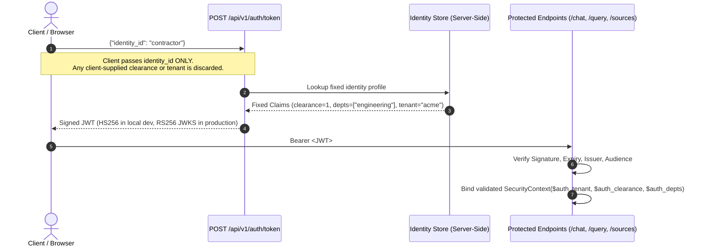
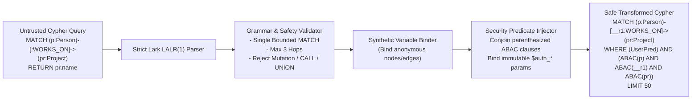
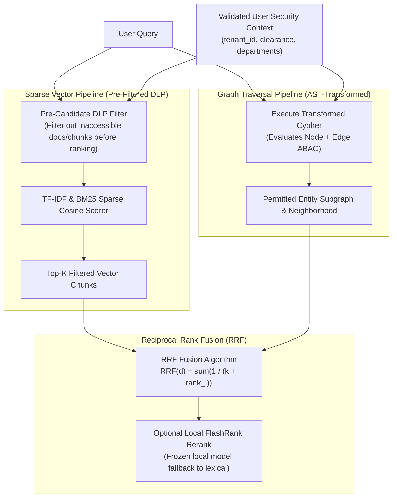
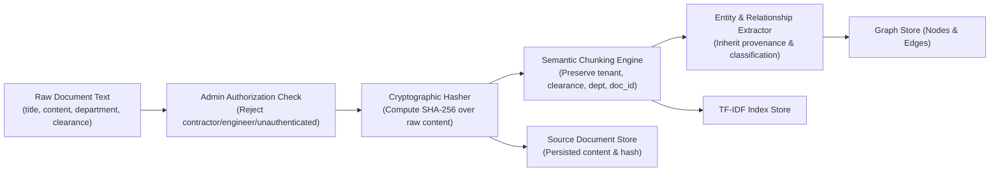

# GraphRAG-DLP System Architecture

## 1. Executive Summary & Core Mission

**GraphRAG-DLP** is a secure, privacy-preserving hybrid Knowledge Graph and Retrieval-Augmented Generation (RAG) platform. Traditional RAG systems and naive GraphRAG pipelines retrieve context indiscriminately across data stores or rely on post-generation prompt-filtering instructions. In enterprise multi-tenant environments, such approaches fail under indirect prompt injection, operator precedence bypasses, and graph traversal cross-contamination.

GraphRAG-DLP enforces strict Attribute-Based Access Control (ABAC), tenant isolation, source provenance verification, and AST-level Cypher query transformation across **every** interaction surface:
1. **Multi-Tenant Hard Partitioning**: Strict multi-tenant isolation where tenant boundaries are cryptographically bound to caller identity tokens.
2. **Every-Surface ABAC**: Granular evaluation of tenant, department, and clearance level on every node, edge, source document, vector chunk, and prompt context item.
3. **Restricted Bounded Cypher AST**: Cypher query rewriting via an abstract syntax tree (AST) grammar that enforces read-only operations, bounds traversal hops ($\le 3$), injects mandatory parameter predicates across all named and synthetic variables, and preserves operator precedence.
4. **Untrusted Prompt Evidence**: Treating all retrieved graph entities and text chunks as untrusted evidence within the LLM context, preventing indirect prompt injection from altering security policy or exfiltrating data.
5. **Grounded Cryptographic Provenance**: Exact linkage between citations, text chunks, and raw source documents via SHA-256 hashes, with uniform 404 anti-oracle error handling.

> [!IMPORTANT]
> **Deterministic Local Mode & Truthful Provider Capabilities:**
> GraphRAG-DLP operates completely out of the box in a zero-external-dependency, deterministic local mode using an in-memory/SQLite graph and pure-Python TF-IDF/BM25 sparse vector search. External services (Neo4j Bolt database, Groq LLM inference, local FlashRank ONNX reranking) are supported via optional provider adapters and are tested truthfully with explicit connection indicators, never masquerading mock vectors as dense neural embeddings.

---

## 2. High-Level System Architecture

The following diagram illustrates the complete end-to-end request flow, trust perimeters, and data pipelines across GraphRAG-DLP:

```mermaid
flowchart TD
    subgraph ClientPerimeter["Client Presentation Layer (Browser)"]
        UI["React 19 + Vite SPA"]
        CytoComp["Cytoscape.js Interactive Graph"]
        AuthCtx["Auth Context (Identity Switcher)"]
        SourceModal["Source Document Viewer (GET /sources/:id)"]
    end

    subgraph APIGateway["FastAPI Gateway & Security Perimeter"]
        AuthMiddleware["JWT ABAC Auth Middleware\n(Zero-Client Claims, Fixed Identities)"]
        APIRouter["API Router (/api/v1)"]
        ChatSSE["Streamed Chat Handler (SSE)"]
        GraphHandler["Graph Query Handler"]
        SourceHandler["Source Evidence Handler"]
    end

    subgraph SecurityKernel["DLP Security Kernel"]
        CypherAST["Restricted Cypher Parser & AST Transformer\n(Lark LALR(1), Bounded MATCH <= 3 hops, Parameter Ingestion)"]
        ABACFilter["Pre-Ranking Candidate ABAC Filter\n(Tenant, Clearance Lattice, Department Fail-Closed)"]
        ProvenanceValidator["Provenance & Hash Validator (SHA-256)"]
        AntiOracle["Anti-Oracle Uniform Error Redactor (Uniform 404)"]
    end

    subgraph RetrievalLayer["Hybrid Retrieval & Knowledge Engine"]
        SparseIndex["Real TF-IDF & BM25 Sparse Vector Store"]
        LocalGraphStore["Real Deterministic Local Graph Store\n(SQLite / NetworkX in-memory)"]
        Neo4jAdapter["Optional Neo4j Bolt Adapter\n(Read-Only Principal, execute_read)"]
        FlashRankAdapter["Local FlashRank ONNX Adapter\n(Frozen Models / Fallback)"]
    end

    subgraph GenerationLayer["RAG Generation & Context Assembler"]
        ContextAssembler["Prompt Context Assembler\n(Untrusted Evidence Framing)"]
        DeterministicLLM["Deterministic Local Template LLM"]
        GroqAdapter["Optional Groq LLM Adapter (API-Backed)"]
        CitationStreamer["SSE Citation & Graph Event Emitter"]
    end

    UI -->|HTTP / SSE| APIGateway
    AuthCtx -->|POST /auth/token (identity_id)| AuthMiddleware
    AuthMiddleware -->|Validated Security Context| APIRouter
    APIRouter --> CypherAST
    APIRouter --> ABACFilter
    APIRouter --> SourceHandler

    CypherAST -->|Safe Parameterized AST| LocalGraphStore
    CypherAST -->|Safe Parameterized AST| Neo4jAdapter
    ABACFilter -->|Pre-Filtered Candidates| SparseIndex
    SparseIndex --> ContextAssembler
    LocalGraphStore --> ContextAssembler
    Neo4jAdapter --> ContextAssembler

    ContextAssembler --> DeterministicLLM
    ContextAssembler --> GroqAdapter
    DeterministicLLM --> CitationStreamer
    GroqAdapter --> CitationStreamer
    CitationStreamer -->|SSE events| ChatSSE
    ChatSSE --> UI
    SourceHandler --> AntiOracle
    AntiOracle --> SourceModal
```

---

## 3. Core Architectural Subsystems

### 3.1 Authentication & ABAC Security Model

Authentication and authorization operate on a zero-trust model where client claims are strictly rejected:



#### Token Issuance & Fixed Identities
- **Endpoint**: `POST /api/v1/auth/token`
- **Request Format**: `{"identity_id": "contractor" | "vp" | "engineer" | "admin" | "other_tenant"}`
- **Security Constraint**: Arbitrary claims in the token request are strictly ignored. The server signs fixed, predefined attributes into the token payload:
  - `user_id`: Unique identifier of the actor.
  - `name`: Display name.
  - `tenant_id`: Mandatory tenant identifier (e.g., `acme` or `cybercorp`).
  - `clearance_level`: Integer clearance lattice ($1 = \text{Public}, 2 = \text{Internal}, 3 = \text{Confidential}, 4 = \text{Secret}$).
  - `departments`: List of authorized departmental strings (e.g., `["engineering"]`, `["procurement", "executive"]`).
  - `roles`: Assigned operational roles (e.g., `["reader"]`, `["admin"]`).
- **Demo Identity Discovery**: `GET /api/v1/auth/identities` exposes fixed identities for demonstration and UI persona switching. In production deployment configurations, this discovery endpoint is disabled.

#### Monotonic Multi-Level Clearance Lattice
Data entities (nodes, edges, chunks, source documents) are tagged with an integer `classification_level` from 1 to 4:
$$\text{Permitted}(u, e) \iff L_{user} \ge L_{entity}$$
Users with lower clearance can never view, traverse, or infer entities of a higher clearance level.

#### Department Matching & Fail-Closed Semantics
To prevent organizational cross-leakage within the same clearance level:
1. An entity with department $D_{entity}$ is accessible to user $u$ with department set $D_{user}$ if and only if:
   $$D_{entity} \in D_{user} \quad \lor \quad D_{entity} \in \{\text{"public"}, \text{"shared"}\}$$
2. **Fail-Closed Rule**: Missing, empty, or `NULL` department values on nodes or edges are **strictly denied** unless explicitly tagged with a recognized canonical shared marker (`"public"` or `"shared"`). `NULL` is never treated as a wildcard.

#### Ingestion Classification Assumptions
The ingestion pipeline enforces role-based access control requiring `role: admin`. However, access control checks at ingestion cannot automatically detect malicious misclassification of document contents:
- **Explicit Trust Assumption**: Correct attribute assignment (tenant, department, clearance) during ingestion is an operational prerequisite. GraphRAG-DLP assumes authenticated ingestors / administrators assign accurate metadata.
- Once ingested, the DLP kernel deterministically prevents unauthorized retrieval, traversal, and display across all consumers.

---

### 3.2 Restricted Cypher Parser & AST Security Transformer

Graph queries submitted to `/api/v1/query/cypher` or generated internally during hybrid retrieval pass through a restricted openCypher Abstract Syntax Tree (AST) transformer implemented with Lark LALR(1).



#### Grammar Scope & Rejection Criteria
The transformer permits a strictly bounded subset of openCypher:
- **Allowed**: Single fixed `MATCH` pattern, optional parameterized `WHERE` clause, explicit `RETURN` property and variable references, and bounded `LIMIT`.
- **Rejected (HTTP 400)**:
  - Mutation clauses: `CREATE`, `MERGE`, `DELETE`, `SET`, `REMOVE`.
  - Disallowed query structures: `OPTIONAL MATCH`, `UNION`, `WITH`, `CALL` (stored procedures), `UNWIND`.
  - Aggregation and window functions: `count()`, `collect()`, `sum()`, `avg()`.
  - Query manipulation: `ORDER BY`, `SKIP`.
  - Variable-length path patterns with unbound hops: e.g., `[:KNOWS*]`, `[:KNOWS*1..10]`. Maximum permitted hop depth is **$\le 3$**.
  - Path variable bindings: e.g., `MATCH p = (a)-[*]->(b)`.

#### AST Rewriting Invariants
1. **Mandatory Variable Binding**: Every node and relationship in the pattern must have a variable. Anonymous elements (e.g., `(p)-[:CONNECTED_TO]->()`) are assigned synthetic variables (e.g., `__gen_r0`, `__gen_n1`).
2. **Operator Precedence Preservation**: If the caller supplied an existing `WHERE` clause $E_{user}$, the rewritten clause wraps both expressions in strict parentheses:
   $$\text{WHERE } (E_{user}) \text{ AND } (\text{SecPred}(v_1) \text{ AND } \text{SecPred}(r_1) \dots)$$
   This prevents `OR` conjunction attacks from bypassing tenant and clearance checks.
3. **Immutable Security Parameter Namespace**: The transformer injects parameterized references:
   - `$auth_tenant_id`
   - `$auth_clearance_level`
   - `$auth_departments`
   
   User-supplied parameters cannot overwrite, shadow, or redefine any `$auth_*` parameter.
4. **Traversal & Result Bounds**: Traversal expansion is strictly bounded at $\le 3$ hops. The transformer enforces a default hard `LIMIT 50` if no smaller limit is specified.

---

### 3.3 Retrieval Engine: Hybrid Search & Provenance Grounding

The retrieval engine combines structured graph traversal with sparse text search:



#### Pre-Ranking DLP Filtering
In both vector and graph retrieval pipelines, unauthorized candidates are eliminated **prior** to similarity scoring and ranking. Chunks or nodes belonging to other tenants or exceeding the caller's clearance level never enter the ranking pool, preventing statistical or rank-order existence leakage.

#### Truthful Provider Adapters
- **Default Deterministic Mode**: Zero external dependencies. Uses an in-memory/SQLite graph and pure-Python TF-IDF vector retrieval.
- **Neo4j Bolt Adapter**: When configured via `NEO4J_URI`, queries execute using the restricted AST against Neo4j. In production environments, Neo4j requires connection as a dedicated read-only principal to enforce database-level immutability. Note that granular per-user read-only RBAC grants require Neo4j Enterprise Edition; in Community Edition deployments, enforcement is handled by the application AST layer, and the connection should use read-only driver routing (`execute_read`).
- **FlashRank ONNX Reranker**: Requires pre-downloaded, frozen ONNX models for offline operation. If the model is absent, the system truthfully falls back to lexical/RRF rank scoring and reports status via `GET /api/v1/health`.
- **Groq LLM Adapter**: Used strictly for prompt answer generation (not for embeddings). When credentials or internet access are unavailable, the deterministic local template engine generates fully grounded answers.

---

### 3.4 Ingestion Pipeline & Provenance Model

Ingestion requires elevated administrative credentials (`role: admin`) and guarantees end-to-end cryptographic lineage:



1. **Cryptographic Grounding**: Every document is assigned a unique `document_id` and a SHA-256 `content_hash` derived from its raw UTF-8 content.
2. **Chunk Attribution**: Every chunk records `document_id`, `chunk_index`, `content_hash`, `tenant_id`, `classification_level`, and `department`.
3. **Graph Entity Lineage**: Extracted nodes and relationships inherit the source document's classification level and record provenance references (`source_document_id`, `chunk_ids`).
4. **Anti-Oracle Source Retrieval**: `GET /api/v1/sources/{document_id}` serves verified source text to authorized users. If a document does not exist, or if the requester's clearance is insufficient, the system returns an **identical HTTP 404 Not Found** response.

---

### 3.5 Streaming Protocol & Anti-Oracle Sanitization

The `/api/v1/chat` endpoint streams interactive RAG completions using Server-Sent Events (SSE).

#### SSE Protocol Event Sequence
1. `event: metadata`
   ```json
   {
     "session_id": "sess_001",
     "tenant_id": "acme",
     "mode": "deterministic_local",
     "pipeline": ["abac_filter", "sparse_tfidf", "cypher_ast", "llm_generate"],
     "safe_transformed_cypher": "MATCH (p:Person)... WHERE ... LIMIT 50"
   }
   ```
   > [!CAUTION]
   > **Metadata Security Invariant**: Metadata events **never** contain blocked-node counts, redacted entity names, existence indicators, or statements such as *"Clearance Level 4 required"*.
2. `event: token`
   Chunked string tokens representing the generated answer.
3. `event: citation`
   Structured citation linking generated assertions to permitted source chunks:
   ```json
   {
     "citation_id": "cite_01",
     "document_id": "doc_titan_charter",
     "document_title": "Titan Project Charter",
     "chunk_id": "doc_titan_charter#c0",
     "snippet": "Alice Vance leads Project Titan under the M&A division...",
     "classification_level": 3,
     "department": "mna",
     "tenant_id": "acme",
     "source_node_ids": ["node_alice", "node_titan"],
     "source_edge_ids": ["edge_leads_titan"]
   }
   ```
4. `event: graph_update`
   Cytoscape-compatible JSON elements containing only the permitted nodes and edges relevant to the generated response.
5. `event: done`
   `{"status": "complete", "total_tokens": 84, "citations_count": 2}`

---

## 4. Frontend UX Contract & Cytoscape Visualization

The frontend is a single-page application (SPA) built with React 19, Vite, Tailwind CSS, and Cytoscape.js:

1. **Header Control Bar**:
   - **Identity Switcher**: Pre-seeded identity pills (`External Contractor [L1]`, `Bob Smith [L2]`, `Alice Vance [L3]`, `Carol Danvers [L4]`, `Dave Bowman [Other Tenant]`). Switching identity immediately mints a new token and refreshes all visual state.
   - **System Status Badge**: Indicates active runtime mode (`Deterministic Local Mode` vs `Connected Adapters`).
2. **Split-Screen Layout**:
   - **Left Pane (45% width)**: Streaming chat conversation, preset scenario buttons (*"Chimera Vendors & Terms"*, *"Alice Titan Acquisition"*, *"Cross-Tenant Canary"*), and rendered citation cards.
   - **Right Pane (55% width)**: Interactive Cytoscape graph canvas using the `cose` layout.
3. **Classification Color Palette**:
   - **Public / Level 1**: Green (`#10B981`)
   - **Internal / Level 2**: Blue (`#3B82F6`)
   - **Confidential / Level 3**: Orange (`#F59E0B`)
   - **Secret / Level 4**: Red (`#EF4444`)
4. **Citation & Source Viewer Modal**:
   - Clicking a citation opens a modal backed by `GET /api/v1/sources/{document_id}` displaying the verified source text, chunk indices, and SHA-256 hash. Inaccessible sources display a generic 404 without leaking document existence.

---

## 5. Architectural Boundaries & Non-Overclaims

To ensure truthful, defensible security claims, the GraphRAG-DLP architecture explicitly specifies its boundaries:
- **No Physical DB Read Impossibility Claims**: When querying databases (Neo4j, SQLite, or disk stores), underlying database storage engines physically read disk blocks or cached pages into memory to evaluate indexes and WHERE clauses. GraphRAG-DLP guarantees that unauthorized data is filtered out before query results are materialized, ranked, or passed to downstream application logic. It does **not** claim physical storage invisibility.
- **No Mathematical Non-Hallucination Guarantees**: LLMs are probabilistic neural models. GraphRAG-DLP does not claim mathematical impossibility of hallucination or exfiltration within LLM weights. Instead, it enforces strict **context sanitization**: unauthorized facts are never placed into the prompt context, making it impossible for the model to leak data it never received.
- **No Uncertified Compliance Claims**: The architecture incorporates technical controls inspired by HIPAA, SOC 2, and GDPR (e.g., ABAC, audit logging, least privilege). However, it makes no claims of formal regulatory certification or audit compliance.
