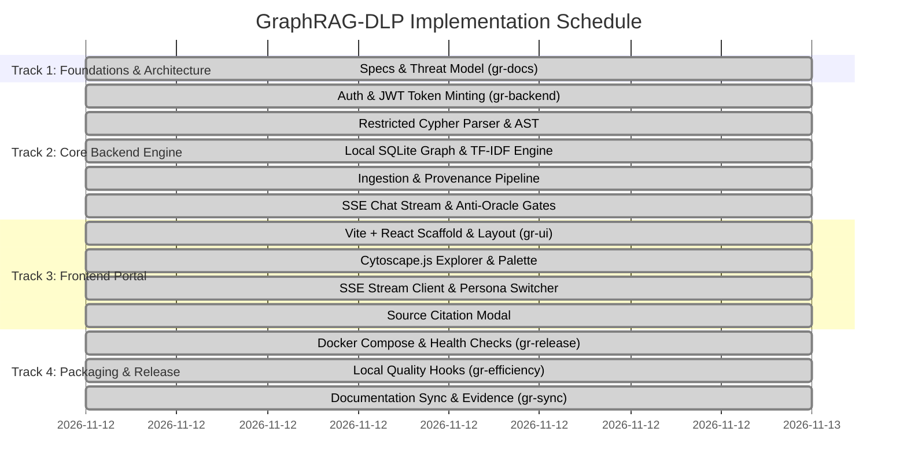

# GraphRAG-DLP Implementation Plan & Verification Matrix

## 1. Executive Summary & Delivery Scope

This document defines the structured implementation plan, work breakdown structure (WBS), and traceability matrix for **GraphRAG-DLP**.

The project implements a secure, hybrid Knowledge Graph and Retrieval-Augmented Generation (RAG) system with verified Attribute-Based Access Control (ABAC), tenant isolation, restricted openCypher AST rewriting, and cryptographic source provenance.

Implementation was executed autonomously across parallel agent lanes under the Firstmate orchestration system (`gr-backend`, `gr-ui`, `gr-efficiency`, `gr-release`, and synchronized by `gr-sync`). In accordance with strict software engineering standards, all test cases and architectural components are mapped directly to empirical test execution evidence.

---

## 2. Traceability Matrix & Acceptance Test Checklist

The following test matrix maps acceptance criteria from the project specification, planner design, and contract overrides to concrete test identifiers, implementation locations, verification methods, and validation statuses:

| Test ID | Category | Description | Implementation & Verification Method | Status | Traceability Reference |
|---|---|---|---|---|---|
| **AUTH-01** | Auth Validation | Reject token request with custom client claims | `POST /api/v1/auth/token` with extra `clearance_level: 4` returns HTTP 422 Unprocessable Entity (Pydantic `extra="forbid"`). | **VERIFIED** | `backend/app/main.py`, `backend/tests/test_security.py::test_claim_injection` |
| **AUTH-02** | Auth Identities | Discover fixed demo identities | `GET /api/v1/auth/identities` returns 5 fixed identities (`contractor`, `engineer`, `vp`, `admin`, `other_tenant`). | **VERIFIED** | `backend/app/security.py`, `backend/tests/test_security.py::test_identities_and_claims` |
| **AUTH-03** | Auth Rejection | Reject invalid, forged, expired, future, or none-alg JWTs | Verify `HTTP 401 Unauthorized` on signature tampering, expired timestamps, bad audience/issuer, and `alg: none`. | **VERIFIED** | `backend/app/security.py`, `backend/tests/test_security.py::test_jwt_rejections` |
| **SEC-01** | AST Parser | Mutation rejection | Submit `MATCH (n) DELETE n RETURN n`. Verify HTTP 400 rejection via Lark AST parser (`CypherError`). | **VERIFIED** | `backend/app/cypher.py`, `backend/tests/test_security.py::test_unsupported_rejected` |
| **SEC-02** | AST Parser | Disallowed syntax rejection | Submit `OPTIONAL MATCH`, `UNION`, `WITH`, `CALL`, `ORDER BY`, `SKIP`, comments (`//`), semicolons, or aggregates. Verify HTTP 400 rejection. | **VERIFIED** | `backend/app/cypher.py`, `backend/tests/test_security.py::test_unsupported_rejected` |
| **SEC-03** | AST Parser | Unbounded query rewrite | Submit `MATCH (n) RETURN n`. Verify rewritten AST enforces `LIMIT 50` (capped at max 100). | **VERIFIED** | `backend/app/cypher.py`, `backend/tests/test_security.py::test_anonymous_and_bounds` |
| **SEC-04** | AST Parser | Anonymous pattern binding | Submit `MATCH (p)-[:KNOWS]->(f)`. Verify synthetic variables `__n*`, `__r*` are bound to security predicates. | **VERIFIED** | `backend/app/cypher.py`, `backend/tests/test_security.py::test_anonymous_and_bounds` |
| **SEC-05** | AST Parser | Hop restriction bound | Submit query with $> 3$ hops (e.g. 4 hops). Verify HTTP 400 rejection. Fixed hops bounded $\le 3$. | **VERIFIED** | `backend/app/cypher.py`, `backend/tests/test_security.py::test_unsupported_rejected` |
| **SEC-06** | AST Parser | Operator precedence isolation | Submit `MATCH (n) WHERE 1=1 OR n.name = 'AWS'`. Verify output wraps `((1=1) OR (n.name = $__literal_0)) AND (SecurityPredicates)`. | **VERIFIED** | `backend/app/cypher.py`, `backend/tests/test_security.py::test_or_precedence_and_parameterization` |
| **SEC-07** | AST Parser | Security parameter isolation | Submit query attempting to define `$auth_tenant_id` or `$__literal_0` in user parameters. Verify HTTP 400 rejection. | **VERIFIED** | `backend/app/cypher.py`, `backend/tests/test_security.py::test_reserved_parameters` |
| **ABAC-01** | Tenant Isolation | Cross-tenant document isolation | Query documents, hybrid search, or Cypher with `other_tenant` JWT. Verify zero Acme documents or nodes returned. | **VERIFIED** | `backend/app/store.py`, `backend/tests/test_security.py::test_terms_policy_all_surfaces[other_tenant-False]` |
| **ABAC-02** | Clearance DLP | Low-clearance payment terms redaction | Contractor queries Chimera payment terms via chat or Cypher. Verify AWS/Snowflake listed, payment terms omitted, no oracle hint. | **VERIFIED** | `backend/app/main.py`, `backend/tests/test_security.py::test_terms_policy_all_surfaces[contractor-False]` |
| **ABAC-03** | Clearance Access | Admin/VP clearance payment terms access | VP / Admin queries Chimera terms. Verify AWS $40k/mo Net-30 and Snowflake $15k/mo Net-60 returned with citations. | **VERIFIED** | `backend/app/main.py`, `backend/tests/test_security.py::test_terms_policy_all_surfaces[vp-True]` |
| **ABAC-04** | Multi-Hop Block | Engineer confidential traversal block | Engineer queries *"What is Alice acquiring?"*. Verify traversal blocked at Project Titan; CyberCorp acquisition unrevealed. | **VERIFIED** | `backend/app/main.py`, `backend/tests/test_security.py::test_two_hop_approval` |
| **ABAC-05** | Multi-Hop Permit | VP confidential traversal permit | VP queries *"Which company did Alice approve for acquisition?"*. Verify returns CyberCorp through Project Titan with citations. | **VERIFIED** | `backend/app/main.py`, `backend/tests/test_security.py::test_two_hop_approval` |
| **ABAC-06** | Department Fail-Closed | Missing department evaluation | Entity or edge with missing or unpermitted department. Verify fail-closed denial. Canonical markers: `"public"`, `"shared"`. | **VERIFIED** | `backend/app/store.py`, `backend/tests/test_security.py::test_provenance_and_every_edge_fail_closed` |
| **SRC-01** | Source Provenance | Authorized source retrieval | VP fetches source document via `GET /api/v1/sources/{document_id}`. Verify HTTP 200 with title, content, hash, classification. | **VERIFIED** | `backend/app/main.py`, `backend/tests/test_security.py::test_source_anti_oracle_and_citations` |
| **SRC-02** | Source Anti-Oracle | Unauthorized source anti-oracle | Contractor fetches confidential source document. Verify HTTP 404 with exact payload `{"detail":"Not found"}` (same as missing). | **VERIFIED** | `backend/app/main.py`, `backend/tests/test_security.py::test_source_anti_oracle_and_citations` |
| **PROV-01** | Ingestion Authorization | Role-based ingestion authorization | Contractor attempts to ingest document via `POST /api/v1/ingest`. Verify HTTP 403 Forbidden (`admin`/`ingestor` required). | **VERIFIED** | `backend/app/main.py`, `backend/tests/test_security.py::test_ingestion_arbitrary_facts_and_tenant` |
| **PROV-02** | Cryptographic Hash | Document SHA-256 integrity & HMAC | Admin ingests document. Verify returned `content_hash` matches SHA-256; HMAC policy signature prevents label tampering. | **VERIFIED** | `backend/app/store.py`, `backend/tests/test_security.py::test_ingestion_arbitrary_facts_and_tenant` |
| **PROV-03** | Citation Lineage | Citation provenance linkage | Inspect SSE `citation` event in chat stream. Verify citation chunk ID, document ID, and entity IDs match database records. | **VERIFIED** | `backend/app/main.py`, `backend/tests/test_security.py::test_chimera_question_graph_has_only_contributing_project` |
| **RAG-01** | Hybrid Fusion | Sparse TF-IDF and Lexical Overlap RRF | Submit search query. Verify valid Reciprocal Rank Fusion scoring, entity anchoring, and candidate filtering. | **VERIFIED** | `backend/app/retrieval.py`, `backend/tests/test_security.py::test_terms_policy_all_surfaces` |
| **RAG-02** | SSE Protocol | Complete SSE stream event cycle | Call `POST /api/v1/chat`. Verify stream emits `metadata`, `token`, `citation`, `graph_update`, `done` in exact sequence. | **VERIFIED** | `backend/app/main.py`, `backend/tests/test_adapters.py::test_groq_actual_stream_protocol_mock` |
| **UI-01** | Cytoscape Visuals | Classification color coding & Viewport | Render nodes in Cytoscape. Verify Level 1-4 color mapping (`#10b981`, `#3b82f6`, `#f59e0b`, `#ef4444`) and 390px mobile responsiveness. | **VERIFIED** | `frontend/src/GraphView.tsx`, `frontend/src/App.test.tsx`, `root-qa/report.md` |
| **SYS-01** | Deterministic Mode | Zero-external-dependency offline execution | Run test suite with no internet, no API keys, and no Docker. Verify 74 passed, 4 skipped in 3.0s. | **VERIFIED** | `uv run pytest backend/tests/` |
| **SYS-02** | Production JWKS | External JWKS configuration requirement | In `APP_ENV=production`, demo endpoints are disabled and valid HTTPS JWKS URL is required. | **VERIFIED** | `backend/app/main.py`, `backend/tests/test_security.py::test_production_jwks_pinned_signature_and_disabled_demo` |

---

## 3. Work Breakdown Structure (WBS) & Implementation Tracks

### Track A: Backend Implementation (`gr-backend` - Commit `b9e9b20`)
1. **Scaffold & Dependencies**: Python 3.13 project configured with FastAPI, Uvicorn, PyJWT, Lark, Pydantic v2, SQLite3.
2. **Restricted Cypher Parser & AST Rewriter** (`backend/app/cypher.py`):
   - Strict Lark LALR(1) parser for read-only single `MATCH` with 0-3 hops.
   - Variable synthesizer for anonymous pattern elements.
   - AST transformer conjoining parenthesized security predicates.
   - Security parameter map builder (`$auth_*`).
3. **Storage & Ingestion Engines** (`backend/app/store.py`):
   - Local persistent SQLite graph store with HMAC policy integrity and atomic key creation (0600).
   - SHA-256 document hashing and deterministic fact extraction.
   - Pre-filtered TF-IDF sparse cosine vector retrieval (`backend/app/retrieval.py`).
4. **API Endpoints & SSE Streaming** (`backend/app/main.py`):
   - `POST /api/v1/auth/token` and `GET /api/v1/auth/identities`.
   - `GET /api/v1/sources/{document_id}` with uniform 404 anti-oracle.
   - `POST /api/v1/chat` streaming SSE events (`metadata`, `token`, `citation`, `graph_update`, `done`).
   - `GET /api/v1/health` reporting truthful mode and adapter connectivity.
5. **Automated Verification**: 78 pytest unit/integration tests with 74 passing out of the box in local deterministic mode.

### Track B: Frontend Vision & Portal (`gr-ui` - Commit `66322ce`)
1. **Project Scaffold**: Vite 7 + React 19 + TypeScript + Tailwind CSS.
2. **Identity & Control Bar**: Seeded persona switcher (`contractor`, `engineer`, `vp`, `admin`, `other_tenant`) refreshing JWT tokens on the fly and immediately resetting chat and graph views.
3. **Conversational Interface**: Split-screen layout with real-time SSE stream processing, markdown token rendering, and scenario triggers.
4. **Cytoscape Graph Canvas**: Dynamic subgraph rendering with classification color badges and interactive node inspection.
5. **Source Citation Drawer**: Clickable citation badges opening modal backed by `GET /api/v1/sources/{document_id}` with Escape key handler.
6. **Mobile Viewport**: Emulated 390x844px mobile view verified with `scrollWidth = 390px` and no horizontal overflow.

### Track C: Packaging, Release & Efficiency (`gr-release`, `gr-efficiency`)
1. **Local Efficiency & Hooks** (Commit `22aec67`): Pre-commit hook, CI workflow, and `./scripts/check.sh` running serial bounded checks passing in 15 seconds.
2. **Release Scaffolding**: Dedicated Docker compose configuration for FastAPI backend, React frontend, and optional Neo4j service.

### Track D: Documentation Synchronization (`gr-sync`)
1. **Artifact Synchronization**: Synchronized `docs/ARCHITECTURE.md`, `docs/SECURITY.md`, `docs/PLAN.md`, `docs/ACCEPTANCE.md`, and `docs/RUNBOOK.md`.
2. **Evidence Grounding**: Verified and incorporated empirical browser evidence from `root-qa/report.md` and test suite execution logs.
