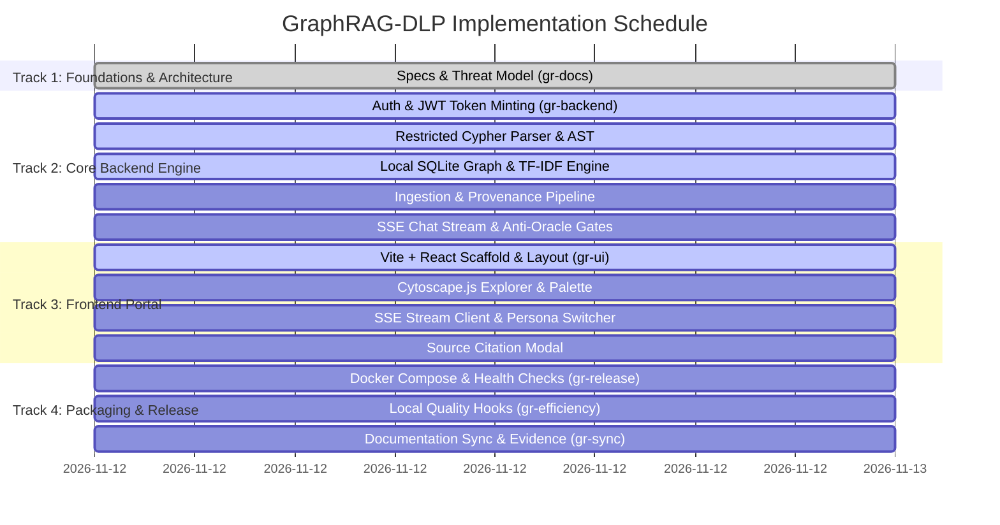
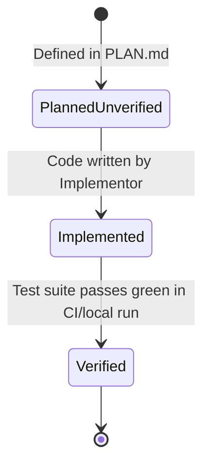

# GraphRAG-DLP Implementation Plan & Verification Matrix

## 1. Executive Summary & Delivery Scope

This document defines the structured implementation plan, work breakdown structure (WBS), and traceability matrix for **GraphRAG-DLP**.

The project implements a secure, hybrid Knowledge Graph and Retrieval-Augmented Generation (RAG) system with verified Attribute-Based Access Control (ABAC), tenant isolation, restricted openCypher AST rewriting, and cryptographic source provenance.

Implementation is executed autonomously across parallel agent lanes under the Firstmate orchestration system. In accordance with strict software engineering standards, all test cases and architectural components are explicitly marked as **[PLANNED / UNVERIFIED]** until empirical test execution evidence is verified by the integration and documentation synchronization agents.

---

## 2. Traceability Matrix & Acceptance Test Checklist

The following test matrix maps acceptance criteria from the project specification and planner design to concrete test identifiers, verification methods, and validation statuses:

| Test ID | Category | Description | Verification Method | Status | Traceability Reference |
|---|---|---|---|---|---|
| **AUTH-01** | Auth Derivation | Request token with custom client claims | Call `POST /api/v1/auth/token` with arbitrary `clearance_level: 4`. Verify server ignores client claims and mints fixed identity clearance. | **[PLANNED / UNVERIFIED]** | `app/api/auth.py`, `tests/test_auth.py` |
| **AUTH-02** | Auth Identities | Discover demo identities | Call `GET /api/v1/auth/identities`. Verify 5 fixed identities returned (`contractor`, `engineer`, `vp`, `admin`, `other_tenant`). | **[PLANNED / UNVERIFIED]** | `app/api/auth.py`, `tests/test_auth.py` |
| **SEC-01** | AST Parser | Mutation rejection | Call `POST /api/v1/query/cypher` with `MATCH (n) DELETE n`. Verify HTTP 400 rejection with `CYPHER_DISALLOWED_OPERATION`. | **[PLANNED / UNVERIFIED]** | `app/cypher/parser.py`, `tests/test_cypher_ast.py` |
| **SEC-02** | AST Parser | Disallowed syntax rejection | Submit `OPTIONAL MATCH`, `UNION`, `WITH`, or `CALL`. Verify HTTP 400 rejection (only single bounded MATCH allowed). | **[PLANNED / UNVERIFIED]** | `app/cypher/parser.py`, `tests/test_cypher_ast.py` |
| **SEC-03** | AST Parser | Unbounded query rewrite | Submit `MATCH (n) RETURN n`. Verify rewritten AST enforces `LIMIT 50`. | **[PLANNED / UNVERIFIED]** | `app/cypher/rewriter.py`, `tests/test_cypher_ast.py` |
| **SEC-04** | AST Parser | Anonymous pattern binding | Submit `MATCH (p)-[:KNOWS]->(f)`. Verify synthetic variables `__gen_r0`, `__gen_n1` are bound to security predicates. | **[PLANNED / UNVERIFIED]** | `app/cypher/rewriter.py`, `tests/test_cypher_ast.py` |
| **SEC-05** | AST Parser | Hop restriction bound | Submit query with $> 3$ hops (e.g., `[:KNOWS*4]`). Verify HTTP 400 rejection. | **[PLANNED / UNVERIFIED]** | `app/cypher/parser.py`, `tests/test_cypher_ast.py` |
| **SEC-06** | AST Parser | Operator precedence isolation | Submit `MATCH (n) WHERE 1=1 OR n.name = 'x'`. Verify output wraps `(1=1 OR n.name = 'x') AND (SecurityPredicates)`. | **[PLANNED / UNVERIFIED]** | `app/cypher/rewriter.py`, `tests/test_cypher_ast.py` |
| **SEC-07** | AST Parser | Security parameter isolation | Submit query attempting to define `$auth_tenant_id` in user parameters. Verify HTTP 400 rejection. | **[PLANNED / UNVERIFIED]** | `app/cypher/rewriter.py`, `tests/test_cypher_ast.py` |
| **ABAC-01** | Tenant Isolation | Cross-tenant document isolation | Query `GET /api/v1/documents` with `other_tenant` JWT. Verify zero Acme documents returned. | **[PLANNED / UNVERIFIED]** | `app/retrieval/hybrid.py`, `tests/test_abac.py` |
| **ABAC-02** | Clearance DLP | Low-clearance payment terms redaction | Contractor queries Chimera payment terms via `POST /api/v1/chat`. Verify AWS/Snowflake listed, terms omitted, no existence hint. | **[PLANNED / UNVERIFIED]** | `app/api/chat.py`, `tests/test_abac.py` |
| **ABAC-03** | Clearance Access | Admin clearance payment terms access | Admin queries Chimera terms via `POST /api/v1/chat`. Verify AWS $40k/mo Net-30 and Snowflake $15k/mo Net-60 returned. | **[PLANNED / UNVERIFIED]** | `app/api/chat.py`, `tests/test_abac.py` |
| **ABAC-04** | Multi-Hop Block | Engineer confidential traversal block | Engineer queries *"What is Alice acquiring?"*. Verify traversal blocked at Project Titan; acquisition unrevealed. | **[PLANNED / UNVERIFIED]** | `app/api/chat.py`, `tests/test_abac.py` |
| **ABAC-05** | Multi-Hop Permit | VP confidential traversal permit | VP queries *"What is Alice acquiring?"*. Verify returns Project Titan acquiring CyberCorp with citations. | **[PLANNED / UNVERIFIED]** | `app/api/chat.py`, `tests/test_abac.py` |
| **ABAC-06** | Department Fail-Closed | Missing department evaluation | Entity with null or missing department queried by engineer. Verify entity denied by default. | **[PLANNED / UNVERIFIED]** | `app/graph/sqlite_store.py`, `tests/test_abac.py` |
| **SRC-01** | Source Provenance | Authorized source retrieval | VP fetches source document for Project Titan charter via `GET /api/v1/sources/{doc_id}`. Verify HTTP 200 with hash and content. | **[PLANNED / UNVERIFIED]** | `app/api/sources.py`, `tests/test_sources.py` |
| **SRC-02** | Source Anti-Oracle | Unauthorized source anti-oracle | Engineer fetches source document for financial contract via `GET /api/v1/sources/{doc_procurement_id}`. Verify HTTP 404. | **[PLANNED / UNVERIFIED]** | `app/api/sources.py`, `tests/test_sources.py` |
| **PROV-01** | Ingestion Authorization | Role-based ingestion authorization | Contractor attempts to ingest document via `POST /api/v1/ingest`. Verify HTTP 403 Forbidden. | **[PLANNED / UNVERIFIED]** | `app/api/ingest.py`, `tests/test_ingestion.py` |
| **PROV-02** | Cryptographic Hash | Document SHA-256 integrity | Admin ingests document. Verify returned `content_hash` exactly matches `sha256(raw_bytes)`. | **[PLANNED / UNVERIFIED]** | `app/ingestion/pipeline.py`, `tests/test_ingestion.py` |
| **PROV-03** | Citation Lineage | Citation provenance linkage | Inspect SSE `citation` event in chat stream. Verify citation chunk ID and document ID match database records. | **[PLANNED / UNVERIFIED]** | `app/retrieval/hybrid.py`, `tests/test_provenance.py` |
| **RAG-01** | Hybrid Fusion | Sparse TF-IDF and BM25 RRF | Submit search query. Verify valid Reciprocal Rank Fusion scoring and rank ordering. | **[PLANNED / UNVERIFIED]** | `app/retrieval/hybrid.py`, `tests/test_retrieval.py` |
| **RAG-02** | SSE Protocol | Complete SSE stream event cycle | Call `POST /api/v1/chat`. Verify stream emits `metadata`, `token`, `citation`, `graph_update`, `done` in exact sequence. | **[PLANNED / UNVERIFIED]** | `app/api/chat.py`, `tests/test_chat_stream.py` |
| **UI-01** | Cytoscape Visuals | Classification color coding | Render nodes in Cytoscape. Verify Level 1-4 color mapping (`#10B981`, `#3B82F6`, `#F59E0B`, `#EF4444`). | **[PLANNED / UNVERIFIED]** | `frontend/src/components/GraphCanvas.tsx` |
| **SYS-01** | Deterministic Mode | Zero-external-dependency offline execution | Run test suite with no internet, no API keys, and no Docker. Verify 100% deterministic test execution. | **[PLANNED / UNVERIFIED]** | `pytest`, `tests/` |

---

## 3. Work Breakdown Structure (WBS) & Implementation Tracks

### Track A: Backend Implementation (`gr-backend`)
1. **Scaffold & Dependencies**: Initialize Python 3.13 project with FastAPI, Uvicorn, PyJWT, Lark, Pydantic v2.
2. **Restricted Cypher Parser & AST Rewriter** (`app/cypher/`):
   - Strict Lark LALR(1) parser for read-only single `MATCH`.
   - Variable synthesizer for anonymous pattern elements.
   - AST transformer conjoining parenthesized security predicates.
   - Security parameter map builder (`$auth_*`).
3. **Storage & Ingestion Engines** (`app/graph/`, `app/ingestion/`):
   - Local SQLite / in-memory graph store with ABAC evaluation.
   - SHA-256 document hashing and semantic chunking.
   - Pre-filtered TF-IDF and BM25 sparse vector index.
4. **API Endpoints & SSE Streaming** (`app/api/`):
   - `POST /api/v1/auth/token` and `GET /api/v1/auth/identities`.
   - `GET /api/v1/sources/{document_id}` with uniform 404 anti-oracle.
   - `POST /api/v1/chat` streaming SSE events (`metadata`, `token`, `citation`, `graph_update`, `done`).
   - `GET /api/v1/health` reporting truthful mode and adapter connectivity.
5. **Automated Verification**: Implement comprehensive `pytest` test suite covering all checklist items.

### Track B: Frontend Vision & Portal (`gr-ui`)
1. **Project Scaffold**: Vite + React 19 + TypeScript + Tailwind CSS.
2. **Identity & Control Bar**: Seeded persona switcher (`contractor`, `engineer`, `vp`, `admin`, `other_tenant`) refreshing JWT tokens on the fly.
3. **Conversational Interface**: Split-screen layout with real-time SSE stream processing, markdown token rendering, and scenario triggers.
4. **Cytoscape Graph Canvas**: Dynamic subgraph rendering with classification color badges and interactive node inspection.
5. **Source Citation Drawer**: Clickable citation badges opening modal backed by `GET /api/v1/sources/{document_id}`.

### Track C: Packaging, Release & Efficiency (`gr-release`, `gr-efficiency`)
1. **Container Packaging**: Local Docker compose setup provisioning FastAPI backend, React frontend, and optional Neo4j service.
2. **Local Efficiency & Hooks**: Pre-commit linting, format validation, and bounded local memory checks suitable for 8GiB environments.

### Track D: Documentation Synchronization (`gr-sync`)
1. **Verification Evidence Gathering**: Inspect passing test suite logs from backend and frontend test runs.
2. **Status Transition**: Update traceability matrix rows from **[PLANNED / UNVERIFIED]** to **[VERIFIED / IMPLEMENTED]** referencing passing test run output.
3. **Final Operational Guide**: Document exact commands for local execution and test verification.

---

## 4. Verification Evidence Contract & Status Lifecycle

To maintain absolute rigor across autonomous agent handoffs, statuses transition through three defined phases:

- **[PLANNED / UNVERIFIED]**: The component or test requirement has been formally specified in `docs/PLAN.md` and `docs/ARCHITECTURE.md`, but empirical execution proof has not yet been registered.
- **[IMPLEMENTED]**: The code has been authored in the repository branches by implementation agents.
- **[VERIFIED]**: Automated tests have executed with green exit status ($0$), producing verifiable test logs traceable to specific test files. Only `gr-sync` or active test runners may promote items to this status.
